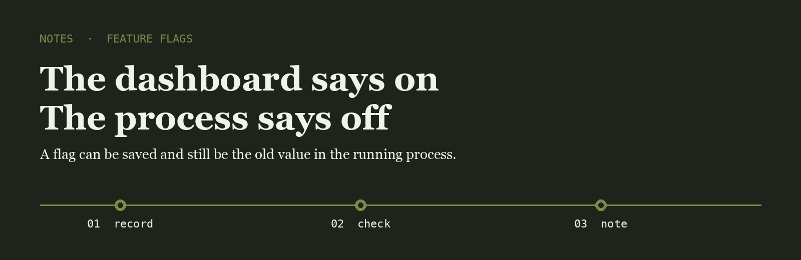
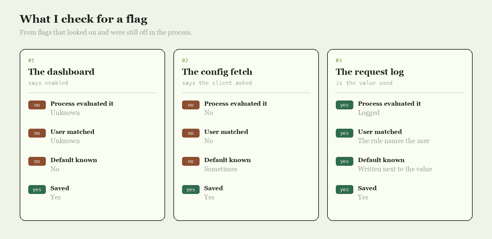

<p align="center">
  
</p>

# Lena Okoye

I compare the flag value in the admin screen with the value the process evaluated for one real user. Those two are often different.

## The question

After you turned the flag on, did one request log the value it evaluated?

<p align="center">
  
</p>

|  | The dashboard | The config fetch | The request log |
| --- | --- | --- | --- |
| Process evaluated it | Unknown | No | Logged |
| User matched | Unknown | No | The rule names the user |
| Default known | No | Sometimes | Written next to the value |
| Saved | Yes | Yes | Yes |

## The line I keep

The line I write when a request shows the evaluated value.

```text
2026-05-02  flag checkout_v2  user 18421  evaluated true  rule staff  default false
```

Saving the flag is solved. Knowing the process evaluated that value is not.

- [unleash](https://github.com/Unleash/unleash) is the flag server I compare the dashboard against
- [flipt](https://github.com/flipt-io/flipt) is the smaller server I use when the rules are in git
- [flagsmith](https://github.com/flagsmith/flagsmith) is the other server I read when a default looks wrong

I keep a fork of each on this account.

## What I pay attention to

- Values logged by the process
- Rules that name the user
- Defaults written next to the value
- One real request after the save

## Working with me

Send a short problem statement, a way to see it happen, and what done looks like. I am independent, remote, and usually around during the Lisbon afternoon.
